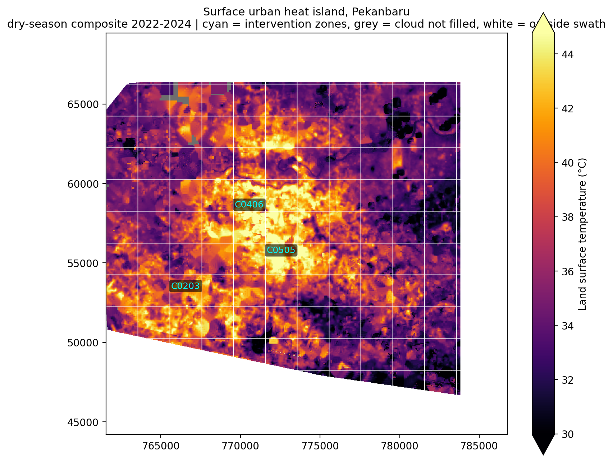
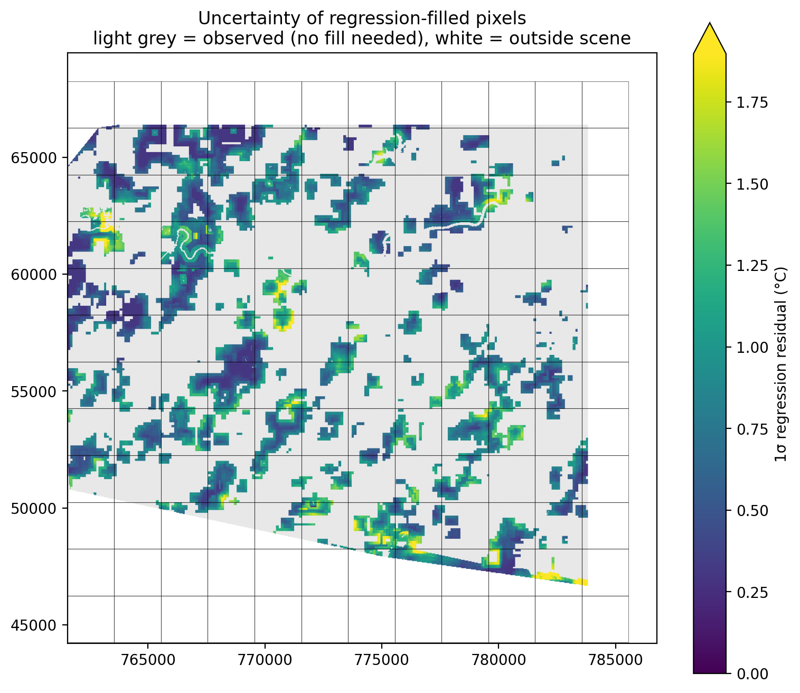
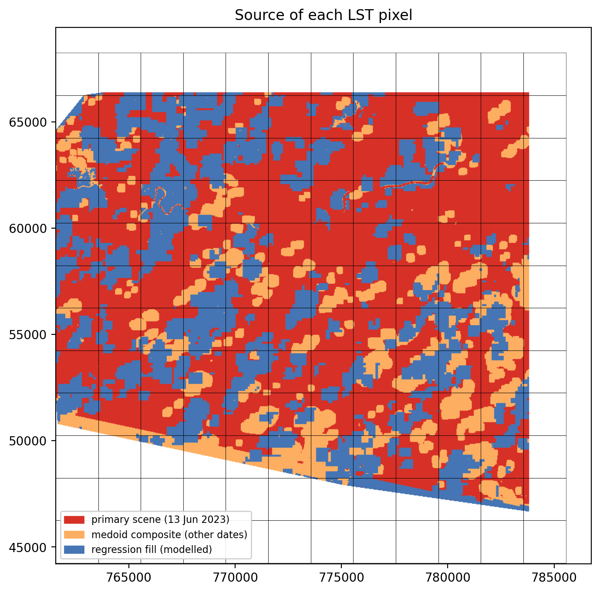

# Surface urban heat island and vegetation loss, Pekanbaru, Indonesia

A reproducible Landsat thermal analysis that maps which parts of Pekanbaru run
hottest, compares that pattern with vegetation change, and ranks three
intervention zones. Built for a data-science portfolio, so the method,
uncertainty and limits are reported as carefully as the result.



*Land surface temperature for a 2022–2024 dry-season composite. Cyan labels mark
the three ranked intervention zones. Grey is cloud that no scene could fill;
white is outside the satellite swath.*

## 1. Question

Pekanbaru (Riau, Sumatra) has grown quickly on peat and mineral soils, and
residents report hotter afternoons. Three questions:

1. Which parts of the city have the highest land surface temperature (LST)?
2. Are the hottest areas also the areas that lost vegetation?
3. Where would a first round of cooling interventions do the most good?

## 2. Study area and data

| Item | Value |
|---|---|
| AOI | 101.35–101.55 °E, 0.40–0.60 °N (about 22 × 22 km) |
| Projection | WGS 84 / UTM zone 47N (EPSG:32647), 30 m grid |
| Thermal source | Landsat 8/9 Collection 2 Level-2, band `ST_B10` |
| Scene grid | WRS-2 path 127, row 59 |
| Period | 2022-01-01 to 2024-12-31 |
| Candidate scenes | 53 |
| Scenes used | 15 with the highest clear share (best 54.4% clear) |
| Reference scene | `LC09_127059_20230613` (13 June 2023, 14.8% cloud) |
| Vegetation change | Landsat 8/9 NDVI, 2022–2024 minus 2016–2018 dry-season medians |
| Analysis units | 144 grid cells of 2 km, standing in for neighbourhoods |

LST conversion follows the USGS Collection 2 specification:

```
LST[K] = DN * 0.00341802 + 149.0
LST[°C] = LST[K] - 273.15
```

Cloud and shadow are removed with `QA_PIXEL` bits 1–4 (dilated cloud, cirrus,
cloud, shadow). Pixels with `ST_B10 = 0` are treated as missing data, not as
cold ground.

## 3. Method

### 3.1 Two-stage gap filling

Cloud in the tropics is not an edge case: the reference scene was only 43.8%
clear. Dropping cloud leaves holes exactly where people live, so the composite
is built in two stages, each with a different claim about what a value means.

**Stage 1: medoid composite (real observations only).** For every pixel, the
clear observations from the 15 selected scenes are compared, and the value
nearest the per-pixel median is kept. This is the medoid: unlike a plain median
it is always one real reading from one real date, never an average of dates.
It raised clear coverage from 43.8% to 56.8% of the raster.

**Stage 2: iterative regression fill (modelled values).** Large cloud blobs
still had no clear observation in any scene. For those pixels a linear model
predicts LST from the mean of the surrounding clear pixels in a 9 × 9 window:

```
LST_pixel = a + b * mean(LST_neighbours) + e
```

The neighbourhood mean excludes the pixel itself, so the model is never fitted
on the value it predicts. Four passes are run: each pass fills a ring one pixel
further into a cloud blob, and newly filled pixels become neighbours for the
next pass. Filling stops at the swath boundary, defined as the convex hull of
every pixel any scene observed, so nothing is invented outside the satellite
footprint.

| Stage | Share of raster | Meaning |
|---|---|---|
| Reference scene only | 43.8% | same-day observation |
| + medoid composite | +13.0% | real observation, different date |
| + regression fill | +23.1% | modelled, not observed |
| **Final coverage** | **79.9%** | |

### 3.2 Uncertainty layer

Every regression-filled pixel carries a 1σ error estimate: the regression
residuals pooled in a moving 25 × 25 window, so heterogeneous urban surfaces
get wider error bars than uniform ones. Median 1σ over filled pixels is
**0.75 K** (95th percentile 1.43 K). The uncertainty is written as a raster and
averaged per grid cell, so the zone table carries its own error estimate.





The provenance map is the honest version of the heatmap: red is the reference
scene, orange is a real observation from another date, blue is modelled. Any
claim about a blue area is weaker than a claim about a red one.

### 3.3 Zonal statistics and prioritisation

Mean, minimum and maximum LST are extracted per 2 km cell, together with the
share of the cell that is observed versus modelled. Each cell is then scored:

```
priority = 0.6 * z(mean LST) + 0.4 * z(-ΔNDVI)
```

Hot cells score high; cells that lost vegetation score high. Missing vegetation
change is treated as zero loss, not as an exclusion, so a cell without a
vegetation record can still rank on heat alone.

## 4. Results

Across the 125 cells with data, mean LST is **35.9 °C**, ranging from 27.9 °C to
43.7 °C, a spread of nearly 16 K within one city. The heat pattern is not
diffuse: it forms a contiguous core north of the Siak river and a second belt
along the eastern built-up corridor, with cooler fringes over vegetated and
peaty ground.

### Top three intervention zones

| Rank | Cell | Mean LST (°C) | ΔNDVI | Priority | Modelled area |
|---|---|---|---|---|---|
| 1 | C0505 | 43.4 | −0.006 | 1.40 | 28.7% |
| 2 | C0406 | 43.7 | +0.001 | 1.19 | 29.2% |
| 3 | C0203 | 40.8 | −0.014 | 1.16 | 13.2% |

All three have complete coverage, so no ranking depends on an extrapolated
pixel. C0406 is the hottest cell in the city; C0505 combines slightly lower heat
with measurable vegetation loss; C0203 is the coolest of the three but lost the
most vegetation, which is why it outranks hotter but greener cells.

### Heat versus vegetation change

Vegetation declined in 113 of 125 cells (mean ΔNDVI −0.009). The correlation
between mean LST and ΔNDVI is **+0.31**: hotter cells tended to lose *less*
vegetation, not more.

That sign is counter-intuitive and worth stating plainly. The likely explanation
is that the hottest cells were already built up and had little vegetation left to
lose, while the largest NDVI losses occurred on vegetated fringes that are
comparatively cool. NDVI change therefore measures where vegetation disappeared,
not where heat is worst. The two signals are complementary, which is why they are
combined in the priority score rather than treated as one confirming the other.

## 5. Limitations

- **The 2 km grid is not a neighbourhood.** No official neighbourhood boundary
  layer was available, so grid cells are a proxy. Real administrative units
  would change the zone boundaries and possibly the ranking.
- **This is not a single-day snapshot.** The composite mixes dates, and surface
  temperature responds to rain, soil moisture and time since cloud. It represents
  typical dry-season conditions, not the afternoon of 13 June 2023.
- **23% of the mapped area is modelled, not measured.** Median 1σ is 0.75 K, but
  the true error in the largest filled blobs is likely larger than a stationary
  regression admits, because it cannot see local surface change between dates.
- **The swath limits the map.** Path 127 leaves the south-west and south-east
  corners uncovered (white). Adding path 126 or 128 would close them.
- **LST is a surface quantity.** It is not air temperature and not the heat a
  pedestrian feels; dense shade can be cool at the surface while trapping heat
  at street level.
- **No emissivity correction beyond the product.** LST relies on the emissivity
  in the Landsat surface temperature product, which is less reliable over
  peatland and water.

## 6. Reproduce

Requires Google Earth Engine authentication and a conda environment (here
`geo`) with `earthengine-api`, `geopandas`, `rasterio`, `shapely`, `scipy`,
`matplotlib`, `pandas`.

```bash
# 1. fetch the reference scene, the 2 km grid and NDVI change
python fetch_inputs.py

# 2. build the medoid composite, then the regression fill + uncertainty
python fill_gaps.py

# 3. zonal statistics, zones and figures
python uhi_pipeline.py \
  --lst-tif inputs/lst.tif --qa-tif inputs/qa.tif \
  --neigh inputs/neigh.gpkg --green inputs/green.gpkg \
  --unc-tif inputs/lst_uncertainty.tif \
  --source-tif inputs/lst_source.tif \
  --footprint-tif inputs/lst_footprint.tif \
  --out outputs
```

Outputs in `outputs/`: `zonal_stats.csv`, `intervention_zones.csv`,
`uhi_heatmap.png`, `lst_uncertainty_map.png`, `lst_provenance_map.png`.

## 7. Files

| File | Role |
|---|---|
| `fetch_inputs.py` | downloads the reference scene, builds the 2 km grid and NDVI change |
| `fill_gaps.py` | medoid composite, iterative regression fill, uncertainty and provenance rasters |
| `uhi_pipeline.py` | QA masking, LST conversion, zonal statistics, priority ranking, figures |

## 8. References

- USGS, *Landsat Collection 2 Level-2 Science Product Guide*: thermal scaling,
  `QA_PIXEL` bit definitions.
- Flood, N. (2013). Seasonal composite Landsat TM/ETM+ images using the medoid
  (multivariate median) approach. *Remote Sensing*, 5(10).
- Zhou, Q., Xian, G. & Shi, H. (2020). Gap fill of land surface temperature and
  reflectance products in Analysis Ready Data. *Remote Sensing*, 12(7), 1192.
- Shi, H. & Xian, G. (2025). Assessing gap-filled Landsat land surface
  temperature time-series data using different observational datasets.
  *International Journal of Remote Sensing*.
- Mueller, C. et al. (2023). Mapping the surface urban heat island effect using
  the Landsat surface temperature product. *IGARSS 2023*.

## Data credit

Landsat 8/9 imagery courtesy of the U.S. Geological Survey and NASA, accessed
through Google Earth Engine. Analysis and figures generated for this portfolio.
